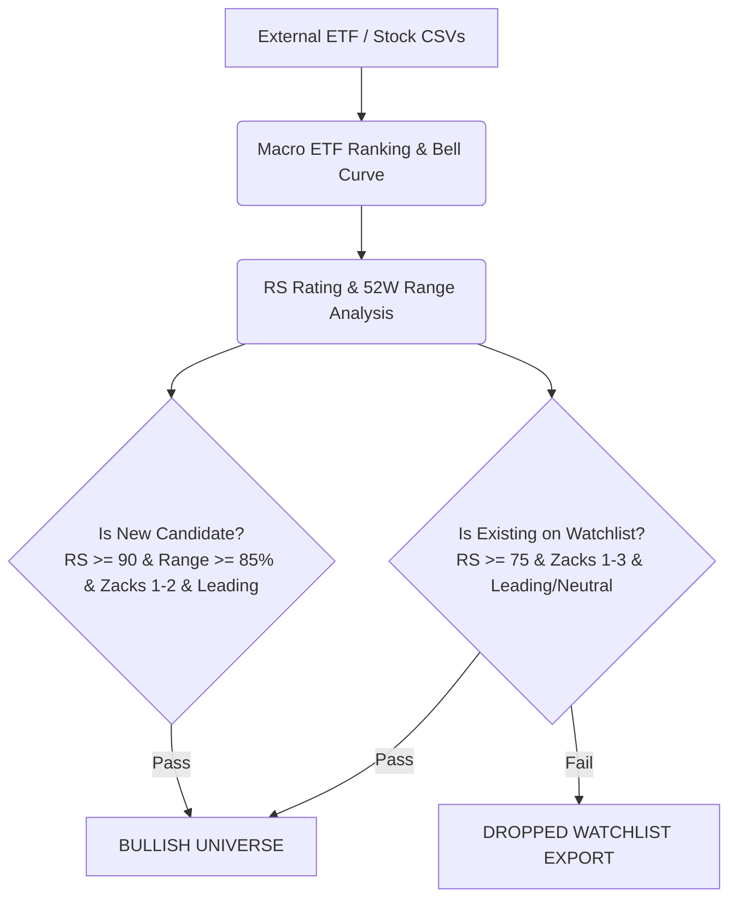

# TABELA Data Flow & Stock Lifecycle Architecture

> **Purpose:** This document maps the authoritative flow of a stock candidate throughout the TABELA Market Intelligence Platform. TABELA V2 uses a **Two-Tier Retention** engine with strict entry gates and tolerant pullback retention:
> 1. **Get-In Gate:** Candidates must prove market leadership near 52-week extremes (`RS >= 90`, `Zacks 1-2`, `Leading Theme`, `52W Range >= 85%`).
> 2. **Stay-In Retention:** Stocks that have qualified remain on the watchlist while pulling back to find support (`RS >= 75`, `Zacks 1-3`, `Leading/Neutral Theme`). They are only dropped if their structural thesis breaks down.

## 1. System Data Flow Diagram

## 2. Definitive Lifecycle Breakdown: The TABELA Retention Engine

TABELA manages whipsawing by decoupling the **initial conviction bar** from the **pullback retention bar**:

### Phase 1: The Initial Entry Cut (Get-In)
To enter the `BULLISH UNIVERSE`:
* **Momentum:** `RS_Rating >= 90`.
* **52W Extreme:** `Price as a % of 52 Wk H-L Range >= 85.0%`.
* **Theme:** Must be `Leading` (Macro) OR `Unclassified Leader`.
* **Fundamentals:** Zacks Rank 1 or 2.

### Phase 2: Pullback Monitoring (Stay-In)
Once drafted, the stock is kept on the active watchlist for chart review while you wait for a favorable risk/reward pullback:
* **Retention Floor:** `RS_Rating >= 75.0`.
* **Theme Tolerance:** Can drift from `Leading` to `Neutral` without ejection.
* **Fundamental Tolerance:** Zacks Rank 1, 2, or 3.
* **Exit:** Ejected into `###Dropped_Bullish_Stocks` only if RS drops < 75, theme degrades to Lagging, or Zacks falls to 4 or 5.

### Phase 3: Short Engine Mirror
To enter the `BEARISH UNIVERSE`:
* **Get-In:** `RS_Rating` between 8 and 60, `52W Range <= 30.0%`, `Theme = Lagging`, `Zacks 3-5`.
* **Stay-In:** `RS_Rating <= 75.0`, `Theme = Lagging/Neutral`, `Zacks 2-5`.

## 3. The Delta Watchlist

Because the engine is perfectly stateless day-over-day, memory is handled purely at the presentation tier out of flat JSON snapshots.
* **Days on List:** The Delta Engine compares today's surviving draft picks against yesterday's file. It visually appends the continuous `Days` a stock has successfully survived the cross-sectional cut.
* **Dropped Details:** If a stock fails to make the draft limits (due to a Theme Downgrade, loss of RS, or simply getting Crowded Out by 3 better stocks), the Delta Engine dynamically extracts the exact metric it failed on and presents it in a daily Exit Log natively in the terminal.
