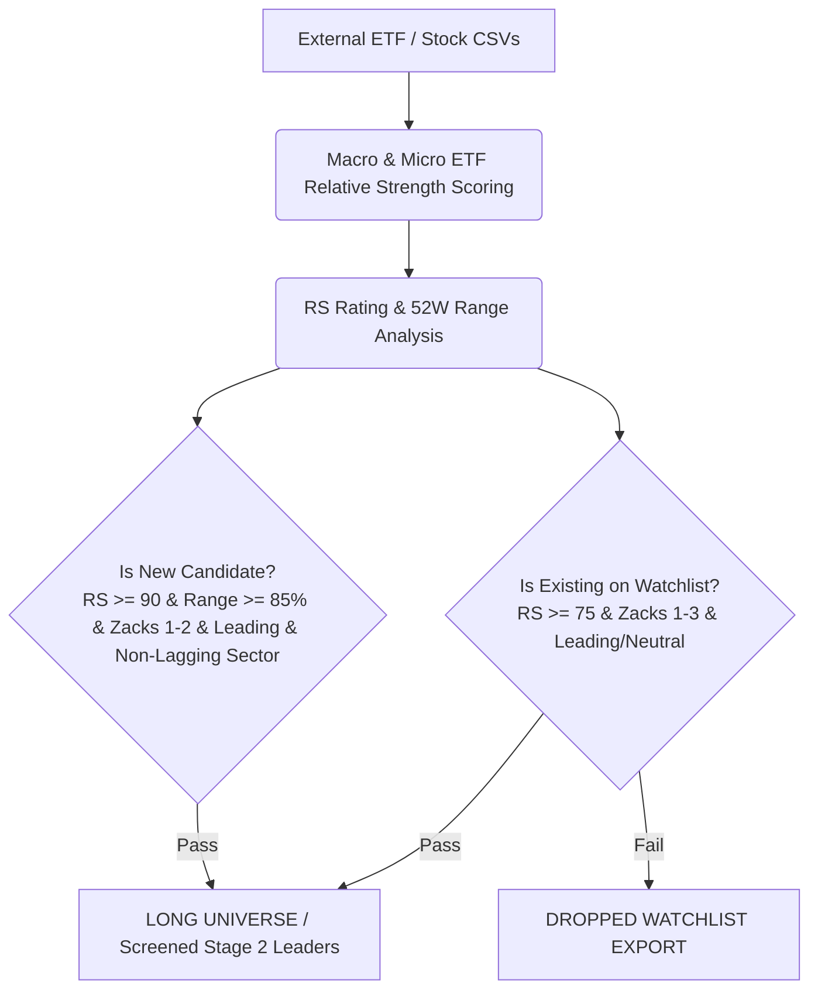

# TABELA Data Flow & Stock Lifecycle Architecture

> **Purpose:** This document maps the authoritative flow of a stock candidate throughout the TABELA Market Intelligence Platform. TABELA V2 uses a **Two-Tier Retention** engine with strict entry gates and tolerant pullback retention:
> 1. **Get-In Gate:** Candidates must prove market leadership near 52-week extremes (`RS >= 90`, `Zacks 1-2`, `Leading Theme`, `52W Range >= 85%`, `Price >= $10`, `Volume >= 1M`).
> 2. **Stay-In Retention:** Stocks that have qualified remain on the watchlist while pulling back to find support (`RS >= 75`, `Zacks 1-3`, `Leading/Neutral Theme`). They are only dropped if their structural thesis breaks down.

## 1. System Data Flow Diagram

## 2. Definitive Lifecycle Breakdown: The TABELA Retention Engine

TABELA manages whipsawing by decoupling the **initial conviction bar** from the **pullback retention bar**:

### Phase 1: The Initial Entry Cut (Get-In)
To enter the `LONG UNIVERSE (Screened Institutional Leaders)`:
* **Momentum:** `RS_Rating >= 90`.
* **52W Extreme:** `Price as a % of 52 Wk H-L Range >= 85.0%`.
* **Theme & Sector:** Must belong to a `Leading Theme` (or `Micro Leader`) AND a Non-Lagging Sector.
* **Fundamentals:** Zacks Rank 1 (Strong Buy) or 2 (Buy).
* **Liquidity & Price:** Price $\ge \$10.00$ and 20-Day Avg Volume $\ge 1,000,000$ (or Market Cap exception).

### Phase 2: Pullback Monitoring (Stay-In)
Once drafted, the stock is kept on the active watchlist for chart review while you wait for a favorable risk/reward pullback:
* **Retention Floor:** `RS_Rating >= 75.0`.
* **Theme Tolerance:** Can drift from `Leading` to `Neutral` without ejection.
* **Fundamental Tolerance:** Zacks Rank 1, 2, or 3.
* **Exit:** Ejected into `###Dropped_Leading_ETF` and recorded in `dropped_history.csv` if RS drops $< 75$, theme degrades to Lagging, sector degrades to Lagging, or Zacks falls to 4 or 5.

### Phase 3: Short Engine Mirror (Stage 4 Candidates)
To enter the `SHORT UNIVERSE (Screened Stage 4 Candidates)`:
* **Get-In:** `RS_Rating` between 8 and 60 (or `Short_RS_Rating`), `52W Range <= 30.0%`, `Theme = Lagging` (or `Micro Lagging`), Non-Leading Sector, `Zacks 3-5`, Price $\ge \$10$, Volume $\ge 1\text{M}$.
* **Stay-In:** `RS_Rating <= 75.0`, `Theme = Lagging/Neutral`, `Zacks 2-5`.

---

## 3. TradingView Watchlist Segregation

The output pipeline renders two distinct watchlists governed by a **Dual-Gate Structural Health Filter** (requiring both relative momentum vs `SPY` and 52-week range positioning):
1. **TRADINGVIEW WATCHLIST : BULLISH**
   - Header: `###leading_ETF,IYK,KIE,XLU,IHI,XRT,XPH,XBI,VNQ,`
   - Gate: Relative Score $\ge 0.0\%$ vs `SPY` **AND** `52W Range >= 50.0%` **AND** $\ge 1$ qualified active stock in the watchlist below.
   - Stock Buckets: Each qualified stock appears under its most granular pure-play ETF (e.g. `###XBI,REPL,VCEL,...`, `###XRT,CROX,WWW,...`).
   - Stocks are listed strictly once (zero duplicates across buckets).
2. **TRADINGVIEW WATCHLIST : BEARISH**
   - Header: `###lagging_ETF,AIQ,BITQ,GDX,SMH,DRAM,SIL,LIT,COPX,NLR,`
   - Gate: Relative Score $< 0.0\%$ vs `SPY` **AND** `52W Range <= 50.0%` **AND** $\ge 1$ qualified active stock in the watchlist below.
   - Stock Buckets: Structurally broken stocks mapped to their thematic short vehicle (e.g. `###SMH,AMBA,AAOI,...`, `###COPX,ERO,FCX,...`).
3. **ACTIONABLE 1:1 PRUNING & NEUTRAL ZONE**
   - **Zero Empty Charts**: Any ETF without at least 1 qualified stock candidate below it (e.g. secondary ETFs like `SOXX`, `IAK`, `IBB` or themes with 0 passing stocks like `TAN`, `IYZ`) is pruned from the header list.
   - Assets failing structural health (e.g. defensive cushions near lows like `VOX`, or high-range pullbacks like `CLOU`) are safely excluded.

---

## 4. The Delta Watchlist & Historical Ledger

Because the engine is perfectly stateless day-over-day, memory is handled purely at the presentation tier out of flat JSON snapshots.
* **Days on List:** The Delta Engine compares today's surviving draft picks against yesterday's file. It visually appends the continuous `Days` a stock has successfully survived the cross-sectional cut.
* **Dropped Ledger:** Ejected candidates are recorded in `market_data/dropped_list/dropped_history.csv` along with their exit metrics for historical performance audit and re-entry monitoring.
